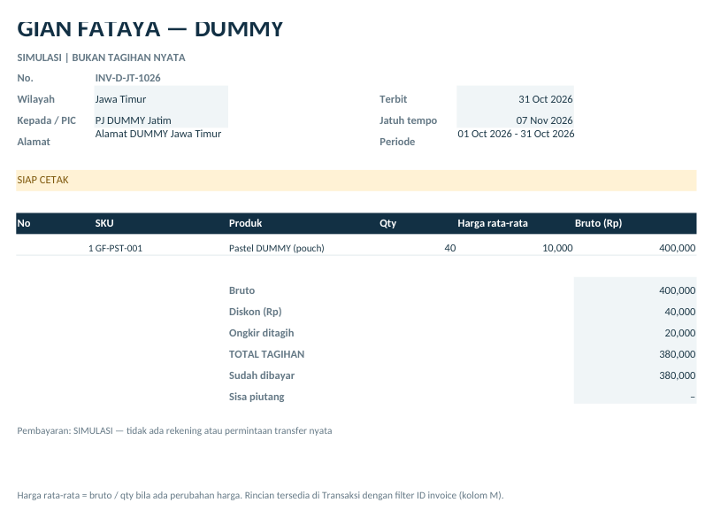
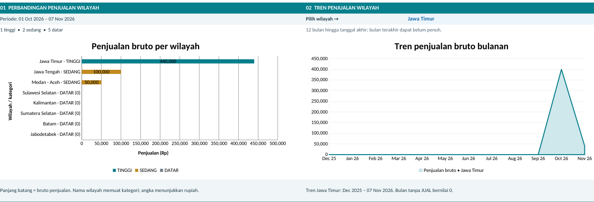

# Gian Fataya — panduan latihan data DUMMY

## Mulai di sini

Gian Fataya • latihan input sampai laporan akhir • versi 7 November 2026

> **DATA DUMMY.** Outlet, PIC, harga jual, lot, transaksi dan pembayaran pada contoh adalah fiktif. Nama delapan wilayah mengikuti MoM. Latihan memakai tabel Excel dan cetak PDF manual, tanpa pemasangan VBA.

### Pilih cara menggunakan paket

| Tujuan | File dan tindakan |
| --- | --- |
| Melihat hasil akhir | Buka POS_Gian_Fataya_DUMMY.xlsx. Semua contoh sudah diisi. Jangan ketik ulang transaksi yang sama. |
| Mencoba dari nol | Buka template_kosong/POS_Gian_Fataya.xlsx → File → Save As → LATIHAN_SAYA.xlsx. Ikuti halaman 2–10 pada salinan ini. |
| Melihat hasil PDF | Buka CONTOH_Invoice_DUMMY_Jatim.pdf. Ini contoh cetakan invoice, bukan tagihan nyata. |

### Urutan kerja

**DATA USAHA → BERANDA (periode) → TRANSAKSI → STOK → TAGIHAN → PEMBAYARAN di TAGIHAN → CETAK INVOICE → BERANDA (hasil).**

Setiap sheet memiliki navigasi baris 4. Untuk ke sel tertentu: klik kotak alamat di kiri bilah rumus, ketik alamat seperti A103, lalu Enter. Untuk berpindah ke pembayaran gunakan tautan pada TAGIHAN baris 5.

### Hasil yang akan Anda cocokkan

| Periode 01/10–07/11/2026 | Hasil akhir |
| --- | --- |
| Penjualan / total tagihan | Rp590.000 / Rp580.000 |
| Pembayaran masuk / piutang | Rp490.000 / Rp90.000 |
| Stok gudang / semua outlet | 60 / 81 pouch |
| Isi contoh | 4 outlet, 11 transaksi, 4 invoice, 4 pembayaran |

> **Saat mengetik:** masukkan nominal tanpa pemisah ribuan, misalnya 10000. Tanggal panduan memakai DD/MM/YYYY; masukkan sebagai tanggal Excel, bukan teks. Diskon 10% diketik 10%, bukan 10. Tampilan 10,000 dan 10.000 bisa berbeda menurut pengaturan regional.

## 1. Lengkapi DATA USAHA

Mulai dari master: lokasi dan lot harus tersedia sebelum transaksi dibuat.

Buka **DATA USAHA**. Sel biru untuk input. Kode wilayah A7:A14 dan namanya sudah tersedia; lengkapi PJ/alamat pada tiga wilayah yang dipakai. Kontak boleh kosong pada latihan.

| Baris | A/B sudah ada | C · PIC Tagihan | D · Alamat Invoice |
| --- | --- | --- | --- |
| 7 | W01 / Jawa Timur | PJ DUMMY Jatim | Alamat DUMMY Jawa Timur |
| 8 | W02 / Jawa Tengah | PJ DUMMY Jateng | Alamat DUMMY Jawa Tengah |
| 9 | W03 / Medan - Aceh | PJ DUMMY Medan | Alamat DUMMY Medan - Aceh |

### Outlet — mulai A36, pertahankan GDG di baris 35

| Baris | A · Kode | B · Nama | C · Wilayah | I · Kelompok |
| --- | --- | --- | --- | --- |
| 36 | D-JT01 | Outlet DUMMY Jatim 1 | W01 | Amanda |
| 37 | D-JT02 | Outlet DUMMY Jatim 2 | W01 | Amanda |
| 38 | D-JTG01 | Toko DUMMY Semarang | W02 | Independen |
| 39 | D-MA01 | Outlet DUMMY Medan | W03 | Amanda |

Untuk setiap outlet isi **D = PIC DUMMY**, **E = Alamat outlet DUMMY**, **G = AKTIF**. F/kontak kosong. **H otomatis** dan harus OK. Gudang GDG tetap berwilayah PUSAT; untuk salinan latihan Anda boleh mengganti nama/PIC gudang menjadi DUMMY.

### Produk, lot dan pengaturan

| Alamat | Isi |
| --- | --- |
| A103 / B103 / C103 | GF-PST-001 / Pastel DUMMY (pouch) / pouch |
| D103 / F103 | 10000 / AKTIF. Harga Rp10.000 hanya untuk latihan. |
| A161 / B161 / D161 | LOT-DUMMY / GF-PST-001 / 31/01/2027 |
| B268 | Pemilik DUMMY |
| B270 | SIMULASI — tidak ada rekening atau permintaan transfer nyata |
| B272 | Alamat pengirim DUMMY — latihan saja |
| B274 / B276 | 30 hari / 50% (ambang kategori TINGGI) |

> **Cek sebelum lanjut:** G7:G9 pada wilayah, H36:H39 pada outlet, H103 pada produk dan F161 pada lot harus OK. C161/nama produk serta kolom HPP acuan otomatis; jangan ditimpa. HPP bawaan bukan harga jual.

## 2–3. Periode, stok awal dan distribusi

Catat stok fisik satu kali, kemudian catat kiriman sesuai PO.

### 2. Atur periode di BERANDA

Isi **B5 = 01/10/2026**, **E5 = 07/11/2026**. Periode ini dipakai untuk hasil gabungan latihan. Biarkan **I18 = Jawa Timur** untuk grafik tren. Tanggal akhir menentukan stok/piutang sampai tanggal tersebut.

### 3. Buka TRANSAKSI dan isi baris berikut

Semua baris menggunakan **E / Kode Lot = LOT-DUMMY**. Kolom G/harga jual dibiarkan kosong untuk AWAL dan KIRIM. **O / Status = AKTIF** sudah menjadi default. J:L otomatis; jangan diisi manual.

| Baris | A · ID | B · Tgl | C · Jenis | D · Lokasi | F · Qty | H · PO | I · Ongkir |
| --- | --- | --- | --- | --- | --- | --- | --- |
| 7 | D-M01 | 01/10/2026 | AWAL | GDG | 200 | kosong | kosong |
| 8 | D-M02 | 02/10/2026 | KIRIM | D-JT01 | 40 | PO-D-001 | 15.000 |
| 9 | D-M03 | 02/10/2026 | KIRIM | D-JT02 | 20 | PO-D-002 | 10.000 |
| 10 | D-M04 | 02/10/2026 | KIRIM | D-JTG01 | 20 | PO-D-003 | 10.000 |
| 11 | D-M05 | 02/10/2026 | KIRIM | D-MA01 | 20 | PO-D-004 | 20.000 |

Isi P/catatan dengan DUMMY bila ingin menandai latihan. N/ekspedisi opsional, misalnya Ekspedisi DUMMY. Klik **+** pada grup kolom M:X bila perlu membuka status/catatan, kemudian tutup kembali agar input ringkas.

### Apa hasilnya sampai tahap ini?

| Pemeriksaan | Angka yang harus terlihat |
| --- | --- |
| BERANDA!E13 / I13 | Stok gudang 100 / stok outlet 100 pouch |
| BERANDA!A8 / E8 / I8 | Penjualan 0 / tagihan 0 / pembayaran 0 |
| TRANSAKSI!J7:J11 | OK semua; KIRIM bukan penjualan |
| Kolom K untuk empat PO | OK; setiap PO minimal 10 pouch |

> **STOK adalah hasil otomatis.** Jangan mengetik saldo di sana. Pada STOK buka filter kolom D/Lot dan pilih LOT-DUMMY untuk melihat lima lokasi. File DUMMY sudah disaring ke lot itu; Data → Clear membuka kembali filter.

## 4. Catat penjualan dan stok bulan berikutnya

Hanya JUAL menambah penjualan; stok yang tersisa dibawa terus.

### Penjualan Oktober — TRANSAKSI baris 12–15

Isi C = **JUAL**, E = **LOT-DUMMY**, G/harga jual = **10000**, O = **AKTIF** pada empat baris ini. H/PO dan I/ongkir kosong. **M/ID invoice masih kosong**; pengaitan dilakukan setelah invoice dibuat pada langkah 5.

| Baris | A · ID | B · Tanggal | D · Lokasi | F · Qty | G · Harga |
| --- | --- | --- | --- | --- | --- |
| 12 | D-M06 | 10/10/2026 | D-JT01 | 30 | 10.000 |
| 13 | D-M07 | 12/10/2026 | D-JT02 | 10 | 10.000 |
| 14 | D-M08 | 15/10/2026 | D-JTG01 | 10 | 10.000 |
| 15 | D-M09 | 20/10/2026 | D-MA01 | 5 | 10.000 |

> **Cek setelah empat penjualan:** terjual 55 pouch, BERANDA!A8 = Rp550.000; gudang 100, outlet 45 pouch. Tagihan/kas masih 0. Bruto belum ditagih (K62) = Rp550.000; ini wajar sampai langkah invoice selesai.

### Lanjut November — tambah dua baris

| Sel / baris | Isi |
| --- | --- |
| A16:F16 | D-M10 / 01/11/2026 / KIRIM / D-JT01 / LOT-DUMMY / 40 |
| G16 / H16 / I16 | kosong / PO-D-005 / 15000 |
| A17:F17 | D-M11 / 05/11/2026 / JUAL / D-JT02 / LOT-DUMMY / 4 |
| G17 / H17 / I17 | 10000 / kosong / kosong |
| O16:O17 / M17 | AKTIF / ID invoice M17 masih kosong dulu |

**D-JT01: 40 dikirim − 30 terjual + 40 kiriman baru = 50 pouch.** Tidak perlu mencatat AWAL lagi pada 1 November. D-JT02 tersisa 20 − 10 − 4 = 6 pouch.

Setelah 11 transaksi: BERANDA!A8 = **Rp590.000**; stok gudang **60**, outlet **81**. Penjualan belum ditagih menjadi Rp590.000 hingga seluruh JUAL dikaitkan ke invoice. Semua J7:J17 harus OK dan L/saldo asal tidak negatif.

## 5. Buat invoice per wilayah

Satu invoice menghimpun penjualan beberapa outlet dalam wilayah/periode yang sama.

Buka **TAGIHAN**, tabel pertama mulai baris 7. Isi A:F berikut. Pada keempat baris isi **I/status = DRAF** dan R/catatan = DUMMY. Periode invoice November hanya sampai 05/11, sesuai penjualan yang ditagih.

| Baris | A · ID Invoice | B · Terbit | C · Area | D–E · Periode | F · Tempo |
| --- | --- | --- | --- | --- | --- |
| 7 | INV-D-JT-1026 | 31/10/2026 | W01 | 01/10/2026 – 31/10/2026 | 07/11/2026 |
| 8 | INV-D-JTG-1026 | 31/10/2026 | W02 | 01/10/2026 – 31/10/2026 | 07/11/2026 |
| 9 | INV-D-MA-1026 | 31/10/2026 | W03 | 01/10/2026 – 31/10/2026 | 07/11/2026 |
| 10 | INV-D-JT-1126 | 06/11/2026 | W01 | 01/11/2026 – 05/11/2026 | 14/11/2026 |

| Baris | G · Diskon | H · Ongkir ditagih | Q yang diharapkan = J/snapshot |
| --- | --- | --- | --- |
| 7 | 10% | 20.000 | 400.000 |
| 8 | 0% | 10.000 | 100.000 |
| 9 | 0% | 0 | 50.000 |
| 10 | 0% | 0 | 40.000 |

### Lakukan berurutan untuk setiap invoice

**1.** Setelah DRAF dibuat, buka TRANSAKSI → klik **+** untuk M:X. Isi **M12 dan M13 = INV-D-JT-1026**, **M14 = INV-D-JTG-1026**, **M15 = INV-D-MA-1026**, **M17 = INV-D-JT-1126**. M pada AWAL/KIRIM tetap kosong.

**2.** Kembali ke TAGIHAN. Q/Bruto Sumber menghitung penjualan tertaut. Salin **Q7 → J7** dengan **Copy → Paste Special → Values / Tempel Nilai**. Ulangi Q8→J8, Q9→J9, Q10→J10. Jangan menaruh rumus =Q7 di J7.

**3.** Pastikan P7:P10 = **OK** dan J cocok dengan Q. Nilai J boleh kosong/menunjukkan CEK NOMINAL selama DRAF belum selesai; jangan diterbitkan sebelum cocok.

**4.** Ubah I7:I10 dari DRAF menjadi **TERBIT**. Jaga angka snapshot tetap. Invoice DRAF belum dihitung sebagai tagihan terbit dan belum siap dicetak.

> **Hasil sebelum pembayaran:** total tagihan Rp580.000; piutang Rp580.000. Invoice Jatim Oktober = 400.000 − (10% × 400.000) + 20.000 = **Rp380.000**, gabungan 30 + 10 pouch dari dua outlet. Ongkir aktual di TRANSAKSI berbeda dari ongkir yang diputuskan untuk ditagih pada invoice.

## 6. Catat pembayaran dan cicilan

Pembayaran mengurangi piutang, tanpa mengubah jumlah produk terjual.

Pada **TAGIHAN** klik **Pembayaran / cicilan** di baris 5, atau gunakan kotak alamat **A437**. Header tabel di baris 436; isi pembayaran mulai baris 437. Pada semua baris D/metode = **Transfer**, F/status = **AKTIF**, G/catatan = **DUMMY**. H:J otomatis.

| Baris | A · ID | B · Tanggal | C · ID Invoice | E · Nominal |
| --- | --- | --- | --- | --- |
| 437 | D-B01 | 31/10/2026 | INV-D-JT-1026 | 100.000 |
| 438 | D-B02 | 03/11/2026 | INV-D-JT-1026 | 280.000 |
| 439 | D-B03 | 04/11/2026 | INV-D-JTG-1026 | 60.000 |
| 440 | D-B04 | 05/11/2026 | INV-D-MA-1026 | 50.000 |

Catat sesuai tanggal uang benar-benar diterima, walaupun data diinput belakangan. Dua pembayaran boleh menunjuk invoice yang sama; ID pembayarannya harus berbeda. I437:I440 harus OK.

### Kembali ke tabel invoice: lihat M, N dan O

| Invoice | L · Total | M · Dibayar | N · Piutang | O · Status |
| --- | --- | --- | --- | --- |
| INV-D-JT-1026 | 380.000 | 380.000 | 0 | LUNAS |
| INV-D-JTG-1026 | 110.000 | 60.000 | 50.000 | SEBAGIAN |
| INV-D-MA-1026 | 50.000 | 50.000 | 0 | LUNAS |
| INV-D-JT-1126 | 40.000 | 0 | 40.000 | BELUM BAYAR |

> **Hasil akhir pembayaran:** Rp100.000 + Rp280.000 + Rp60.000 + Rp50.000 = **Rp490.000**. Sisa piutang = Rp580.000 − Rp490.000 = **Rp90.000**. Jangan mengisi M/N/status bayar manual; semuanya hasil rumus.

### Mengapa total tagihan berbeda dari bruto penjualan?

Bruto Rp590.000 dikurangi diskon Rp40.000 lalu ditambah ongkir ditagih Rp30.000 menghasilkan tagihan Rp580.000. Pembayaran masuk Rp490.000 adalah penerimaan pelanggan, bukan laba atau saldo kas bersih setelah seluruh biaya usaha.

## 7. Lihat dan ekspor invoice PDF

Hasil cetak terpisah per wilayah; contoh ini memakai Jatim Oktober.

**1.** Buka **CETAK INVOICE**. **2.** Pilih **B5 = INV-D-JT-1026**. **3.** A14 harus **SIAP CETAK**; penerima adalah PJ DUMMY Jatim dan alamat dummy, bukan setiap outlet.

**4.** Cocokkan qty **40**, bruto **Rp400.000**, diskon **Rp40.000**, ongkir **Rp20.000**, total **Rp380.000**, dibayar **Rp380.000**, sisa **0**. File DUMMY sudah menyembunyikan baris produk kosong 18–66; saat latihan dari template kosong, pilih baris 18–66 → klik kanan → Hide agar cetakan ringkas.

**5.** Excel: **File → Print**, pilih **Print Active Sheets**, periksa satu halaman A4 portrait, lalu **Microsoft Print to PDF / Save as PDF**. Alternatif: File → Export → Create PDF, pilih Active sheet(s). LibreOffice: File → Export As → PDF, gunakan area cetak sheet invoice. **6.** Simpan sebagai **Invoice_DUMMY_Jatim.pdf**.

> Ganti B5 untuk invoice lain. Contoh Jateng: total Rp110.000, dibayar Rp60.000, sisa Rp50.000. Jangan mengubah isi cetakan langsung; perbaiki data sumber jika ada kesalahan.

## 8. Baca dashboard dan grafik wilayah

Kembali ke BERANDA dengan periode 01/10–07/11/2026.

| Sel | Angka yang diharapkan | Artinya |
| --- | --- | --- |
| A8 | Rp590.000 | Bruto seluruh JUAL valid pada periode |
| E8 | Rp580.000 | Invoice TERBIT dalam periode |
| I8 | Rp490.000 | Pembayaran masuk dalam periode |
| A13 | Rp90.000 | Piutang sampai tanggal akhir |
| E13 / I13 | 60 / 81 pouch | Stok gudang / semua outlet sampai tanggal akhir |

**Grafik kiri:** Jawa Timur Rp440.000 (**TINGGI**), Jawa Tengah Rp100.000 dan Medan–Aceh Rp50.000 (**SEDANG**). Lima wilayah lain **DATAR (0)**. Ringkasan: 1 tinggi, 2 sedang, 5 datar. Toko independen Semarang ikut Jawa Tengah.

**Grafik kanan:** pilih wilayah pada **I18**. Untuk Jawa Timur, Oktober Rp400.000 dan November sampai 7 November Rp40.000. Rentang selalu 12 bulan sampai E5; bulan sebelum ada penjualan bernilai 0. B5 mengubah perbandingan kiri, bukan panjang rentang tren.

> TINGGI = bruto minimal 50% area teratas; SEDANG = positif di bawah ambang; DATAR = nol. Ambang dapat diubah di DATA USAHA!B276. Ini pembanding antarwilayah, bukan ukuran pertumbuhan atau target laba. Data November belum satu bulan penuh.

## 9. Coba filter periode dan wilayah

Ubah hanya sel biru pada salinan latihan, lalu pulihkan ke periode awal.

Ganti **BERANDA!B5/E5** sesuai tabel. Angka di bawah adalah hasil hitung ulang dari transaksi yang sama, tanpa menambah/menghapus jurnal.

| B5–E5 (2026) | Bruto | Tagihan | Kas masuk | Piutang | Gudang | Outlet |
| --- | --- | --- | --- | --- | --- | --- |
| 01/10–07/11 | 590.000 | 580.000 | 490.000 | 90.000 | 60 | 81 |
| 01/10–31/10 | 550.000 | 540.000 | 100.000 | 440.000 | 100 | 45 |
| 01/11–07/11 | 40.000 | 40.000 | 390.000 | 90.000 | 60 | 81 |

> Bruto, tagihan terbit dan penerimaan memakai rentang B5–E5. Stok dan piutang memakai **akumulasi sampai E5**. Karena itu piutang November tetap mencakup invoice Oktober yang belum lunas; pembayaran November tidak mengurangi piutang historis pada 31 Oktober.

**TAGIHAN** menampilkan status bayar terkini dari seluruh pembayaran yang sudah dicatat. Status tersebut tidak ikut menjadi historis ketika filter Beranda diganti. Untuk piutang pada tanggal tertentu, baca BERANDA!A13.

### Ganti pilihan wilayah untuk tren

| Pilihan I18 | Oktober | November s.d. 07/11 |
| --- | --- | --- |
| Jawa Timur | 400.000 | 40.000 |
| Jawa Tengah | 100.000 | 0 |
| Medan - Aceh | 50.000 | 0 |

Pulihkan **B5 = 01/10/2026**, **E5 = 07/11/2026**, **I18 = Jawa Timur** setelah mencoba. Ctrl+S untuk menyimpan.

### Bulan berikutnya mulai dari mana?

Gunakan file kerja yang sama dan lanjutkan di baris TRANSAKSI berikutnya (**18** pada contoh). Catat PO/penjualan baru; jangan ulangi AWAL atau menyalin saldo sebagai transaksi baru. Invoice berikutnya di TAGIHAN baris **11**, pembayaran berikutnya di baris **441**. Beri ID baru yang unik, lalu ubah periode laporan sesuai kebutuhan.

Sebelum mengoreksi data periode lama, simpan arsip bulanan. Untuk penggunaan usaha nyata, mulai dari template kosong dan isi data aktual milik mitra; jangan memakai stok/harga/outlet DUMMY sebagai saldo pembukaan usaha.

## 10. Cocokkan hasil dan selesaikan latihan

Gunakan daftar ini untuk memastikan seluruh alur sudah berjalan.

### Stok akhir per lokasi — STOK, filter LOT-DUMMY

| Lokasi | Perhitungan | Saldo akhir |
| --- | --- | --- |
| GDG | 200 − (40 + 20 + 20 + 20 + 40) | 60 |
| D-JT01 | 40 − 30 + 40 | 50 |
| D-JT02 | 20 − 10 − 4 | 6 |
| D-JTG01 | 20 − 10 | 10 |
| D-MA01 | 20 − 5 | 15 |
| TOTAL | 200 awal − 59 terjual | 141 = 60 gudang + 81 outlet |

**Pemeriksaan akhir:** J7:J17 di TRANSAKSI, P7:P10 di TAGIHAN, I437:I440 pada pembayaran semuanya OK. BERANDA!I57/C60/G60/K60/C62/G62/K62 semuanya 0. Sisa piutang Rp90.000 adalah saldo sah dari dua invoice, bukan kesalahan input.

### Jika hasil belum cocok

| Gejala | Periksa dan perbaiki |
| --- | --- |
| Cannot open the specified file | Gunakan file versi perbaikan. Untuk satu tombol pada salinan lama: klik kanan → Edit Hyperlink → Place in This Document → sheet tujuan, misalnya STOK!A1. |
| J bukan OK / angka tidak masuk | Cek kode outlet dan lot di master, tanggal valid, qty positif, status AKTIF; harga wajib hanya untuk JUAL, nomor PO wajib untuk KIRIM. |
| PO < 10 PCS / saldo negatif | Lengkapi PO minimal 10 pcs per nomor PO + outlet; cek stok sebelum kirim/jual. Jangan menimpa rumus atau saldo STOK. |
| CEK NOMINAL / SELISIH SUMBER | Cek diskon (10%, bukan 10), ongkir 0 bila nihil, tautan ID invoice di TRANSAKSI M, serta snapshot J sama dengan sumber Q. Jangan mengubah penjualan yang sudah ditagih. |
| PDF belum SIAP CETAK | Invoice harus TERBIT dan P = OK; lengkapi PIC/alamat wilayah. Pilih ID yang benar di CETAK INVOICE!B5. |
| Pembayaran tidak dihitung | Pilih invoice TERBIT, tanggal tidak sebelum tanggal terbit, nominal positif, metode Transfer, status AKTIF; cek kolom I pembayaran. |
| Grafik tampak nol / angka tidak berubah | Cek B5/E5 dan I18; pilih Formulas → Calculation Options → Automatic, lalu F9. Jangan mengubah sumber/rumus grafik. |

> **Hasil yang dibawa pulang:** Excel berisi jurnal, stok berjalan, empat invoice beserta status bayar, dua grafik wilayah, serta contoh PDF invoice. Simpan LATIHAN_SAYA.xlsx dan PDF hasil latihan. Rumus, tujuh tahap dan render contoh diuji dengan LibreOffice; Microsoft Excel desktop dan VBA belum dieksekusi di lingkungan ini.
